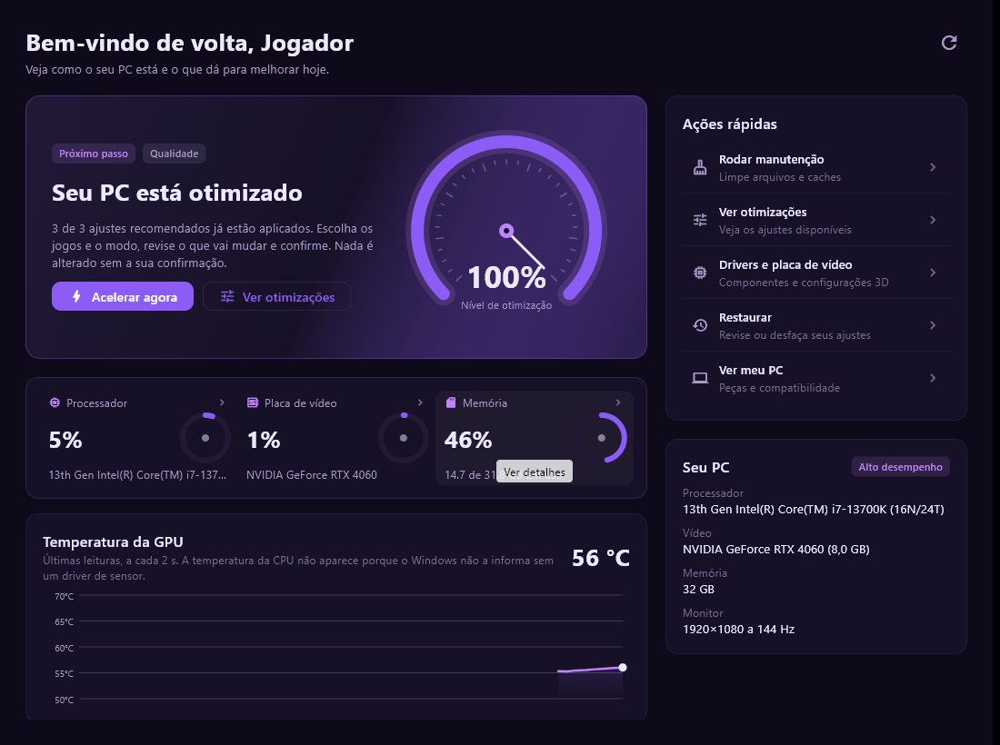
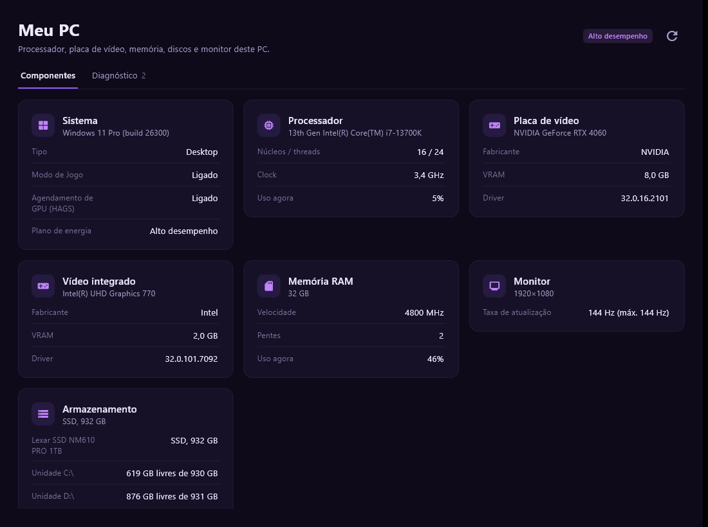
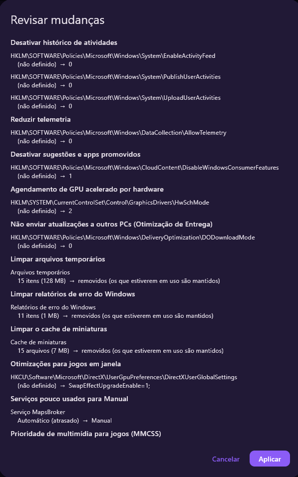
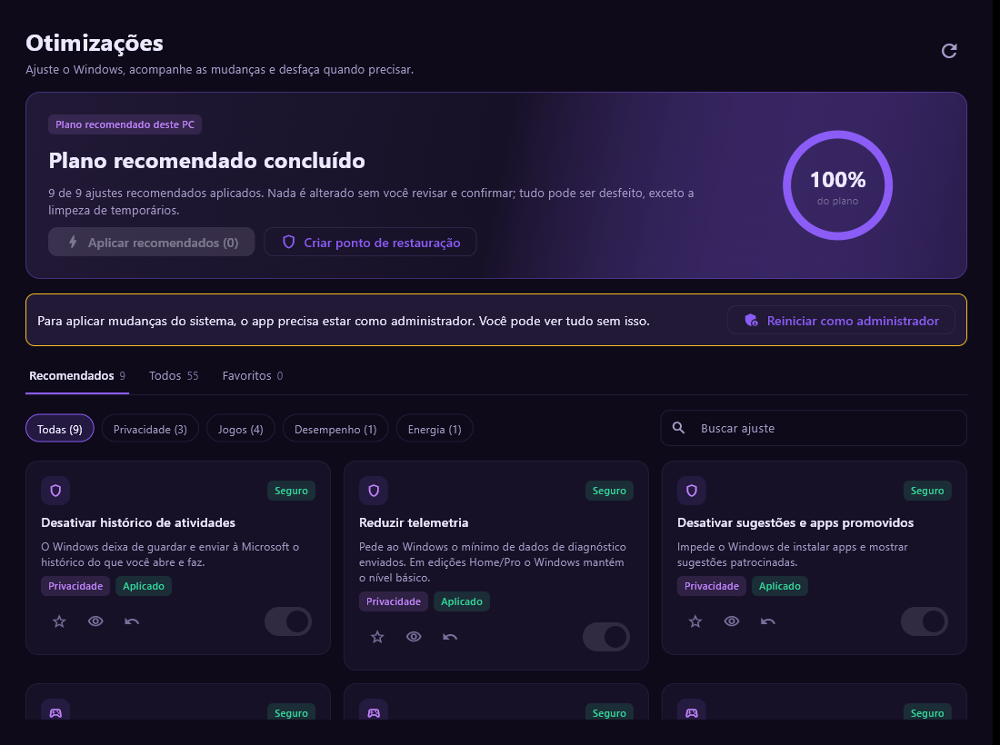
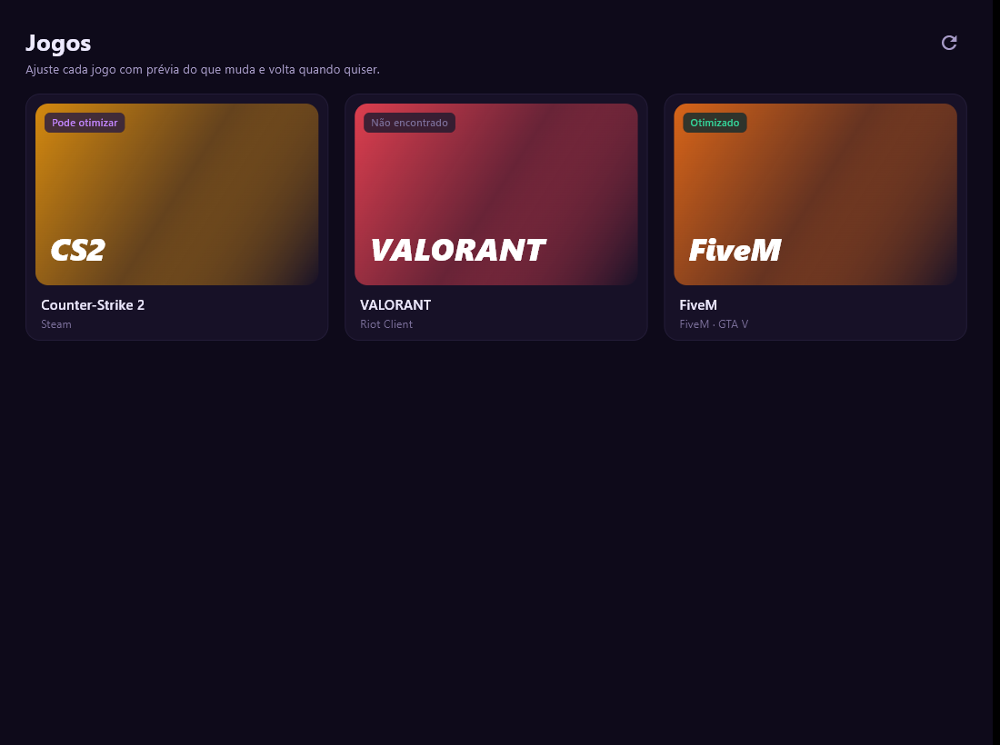
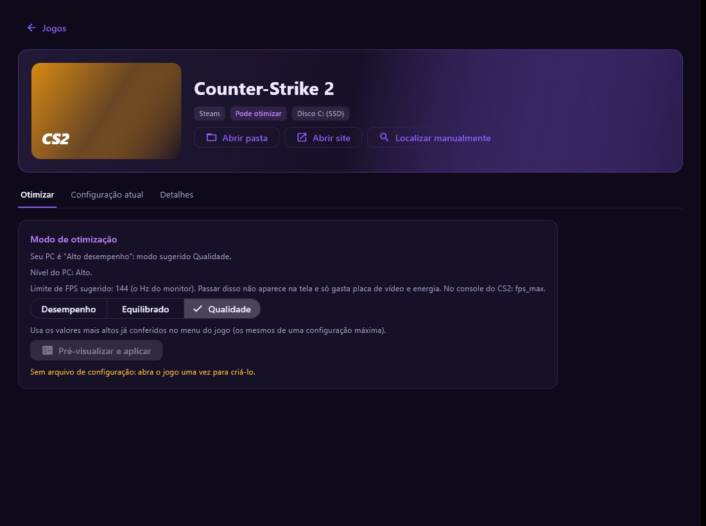

# Optia Tweaks

### Deixe o seu PC pronto para jogar FiveM, Counter-Strike 2 e VALORANT — com segurança e sem complicação.

---

## O problema

O Windows vem configurado para servir todo mundo: trabalho, escritório, uso doméstico. Para jogar, isso significa:

- **Recursos gastos com o que você não usa:** gravação em segundo plano, histórico de atividades, aplicativos que ficam abertos sem você saber, efeitos visuais.
- **Configurações de jogo que não combinam com o seu PC:** gráficos pesados demais para uma máquina simples, ou leves demais para uma máquina potente.
- **Ajustes espalhados por dezenas de telas e do registro do Windows.** Quem tenta fazer sozinho acaba seguindo tutorial da internet, sem saber o que cada mudança faz nem como desfazer.

O resultado: quedas de FPS, travadas, mais atraso (latência) e um PC que parece mais lento do que é.

---

## A solução

O **Optia Tweaks** é um aplicativo para Windows 10 e 11, em português, que **analisa o seu PC, mostra o que dá para melhorar e aplica os ajustes por você**, sempre pedindo a sua confirmação antes.

Pensado para três jogos: **FiveM**, **Counter-Strike 2** e **VALORANT**.

> Você escolhe os jogos e o modo. O app mostra o que vai mudar. Você confirma. Se não gostar, desfaz.

*Tela inicial: um botão principal, o nível de otimização do PC e as leituras ao vivo de processador, placa de vídeo e memória.*

---

## Como funciona (3 passos)

1. **Analisa** — reconhece o seu processador, placa de vídeo, memória, discos e monitor, e encontra os jogos instalados.
2. **Mostra** — apresenta cada mudança com o valor de hoje e o valor novo (de → para), com o nível de risco de cada uma.
3. **Aplica** — depois da sua confirmação, cria um ponto de restauração do Windows e aplica. Tudo fica registrado no histórico.

*Passo 1: o app reconhece as peças do seu PC.*

*Passo 2: antes de aplicar, a janela "Revisar mudanças" mostra cada alteração, do valor de hoje para o valor novo. Nada muda sem o seu "Aplicar".*

---

## O que ele melhora

### No Windows
- **Menos coisas rodando em segundo plano:** apps em segundo plano, widgets, gravação de jogo em segundo plano (Game DVR), Edge aberto sem necessidade.
- **Configurações pensadas para jogos:** Modo de Jogo ligado, agendamento de GPU acelerado por hardware, aceleração do mouse desligada, otimizações para jogos em janela.
- **Energia e rede:** plano de energia de alto desempenho, economia de energia de Wi-Fi, placa de rede e USB desligadas quando atrapalham.
- **Privacidade:** telemetria reduzida, histórico de atividades desligado, sugestões e anúncios do Windows desativados, permissões de aplicativos bloqueáveis.
- **Limpeza:** arquivos temporários, relatórios de erro, cache de miniaturas, cache do FiveM e Lixeira, com o tamanho mostrado antes de apagar.

*Cada ajuste é um cartão com o risco indicado (por exemplo "Seguro"), um botão para ver o que muda e outro para desfazer.*

### Nos jogos
- **Modos por jogo: Desempenho, Equilibrado e Qualidade.** O app lê a configuração atual, explica em linguagem simples e aplica o modo escolhido nos arquivos de configuração do **CS2** e do **FiveM**. Para o **VALORANT**, mostra o passo a passo dentro do jogo.
- **FiveM:** perfis PvP, Equilibrado e RP, e limpeza de cache.
- **Sugestão de limite de FPS** de acordo com o seu monitor e o seu PC.

*A biblioteca mostra o estado de cada jogo: "Pode otimizar", "Otimizado" ou "Não encontrado".*

*Em cada jogo, você escolhe o modo e vê a sugestão de limite de FPS para o seu monitor.*

### Na placa de vídeo
- **NVIDIA:** configurações 3D por jogo e por modo, com os nomes oficiais; algumas opções são aplicadas direto no perfil do jogo, com o valor original guardado.
- **AMD:** guias por jogo.
- **Drivers e componentes:** verifica driver de vídeo, Visual C++, DirectX e .NET.

### No dia a dia
- **Início com um botão:** "Acelerar agora" faz o caminho recomendado para o seu PC.
- **Monitor ao vivo** de CPU, GPU e memória.
- **Rede e DNS:** testa 5 provedores públicos e mostra qual responde mais rápido.
- **Programas de inicialização:** liste e desative o que abre com o Windows, sem apagar nada.

---

## Por que você precisa dele

| Sem o Optia Tweaks | Com o Optia Tweaks |
|---|---|
| Ajustes espalhados, tutoriais da internet | Tudo em um só lugar, em português |
| Não sabe o que cada mudança faz | Cada ajuste explicado e com o risco indicado |
| Medo de quebrar o Windows | Ponto de restauração, backup e "Desfazer" em todos os ajustes que mudam configurações |
| Não sabe se melhorou | Medição antes e depois (processos, memória, CPU, GPU, rede e, com o PresentMon, FPS) |
| Configurações de jogo no chute | Modos por jogo, com o valor de cada opção |

---

## Desempenho: o que esperar (com honestidade)

Cada PC é diferente, e **o ganho depende do que o seu computador tem de errado hoje**. Por isso o Optia Tweaks não promete um número de FPS: ele **mede para você**.

- **Mais impacto** em PCs com muitos programas em segundo plano, configurações padrão de fábrica, plano de energia econômico ou jogos rodando no gráfico errado.
- **Menos impacto** em PCs já bem cuidados. Nesses casos o app diz "sem diferença" em vez de inventar ganho.
- **Medição incluída:** o cartão "O que melhorou" compara o seu PC antes e depois, com tolerância de ruído para não vender melhora que não existe. O teste de FPS guiado (3 rodadas de 20 s) usa o PresentMon, que você indica.
- **Ajustes de energia, rede e privacidade** podem não aparecer como "mais FPS": eles ajudam na estabilidade, no consumo e na latência.

---

## Segurança: o que ele nunca faz

- **Nunca** lê ou altera a memória dos jogos nem os arquivos instalados deles.
- **Nunca** mexe em anti-cheat (Vanguard, VAC, FiveM).
- **Nunca** desativa Windows Update, Defender, Firewall ou UAC.
- **Nunca** faz overclock.
- **Nada é aplicado sem prévia e confirmação.** Ajustes de maior risco ficam em uma seção separada, com aviso, e **não** entram no botão "Acelerar agora".
- **Sem telemetria:** o app não envia dados do seu PC. A internet é usada para validar a licença e, com a sua permissão, para baixar drivers e componentes de sites oficiais.
- Downloads só de domínios oficiais, com assinatura digital verificada.

---

## Para quem é

- **Jogadores de CS2, VALORANT e FiveM** que querem o PC no ponto sem virar especialista.
- **Quem tem PC de entrada ou médio** e precisa tirar o máximo do que tem.
- **Quem joga FiveM em servidor de RP** e quer estabilidade, com o perfil certo para o tipo de servidor.
- **Quem cuida do PC de outras pessoas** e quer um padrão repetível, com relatório para suporte.

---

## Planos

| Plano | Preço |
|---|---|
| **Mensal** | R$ 19,99 |
| **Anual** | R$ 79,99 |
| **Lifetime** | R$ 179,99 |

**Todos os planos incluem suporte humano.** Uma pessoa acompanha o seu caso para melhorar ainda mais a sua experiência e o desempenho do seu computador, em vez de deixar você sozinho com um programa.

---

## Perguntas frequentes

**Vai me banir de algum jogo?**
O app não toca nos jogos nem no anti-cheat; só lê o nome do processo para saber se o jogo está aberto. Ainda assim, cada jogo tem as suas regras: o app foi desenhado para não interferir.

**E se eu não gostar do resultado?**
Há "Desfazer item" e "Desfazer tudo" no histórico, além do ponto de restauração do Windows criado antes das mudanças. As únicas ações que não voltam são as limpezas de arquivos, e o app avisa antes.

**Preciso ser administrador?**
Para aplicar ajustes do sistema, sim: o app pede a permissão do Windows quando for necessário. Sem ela, ele só lê e mostra.

**O suporte é feito por uma pessoa?**
Sim. Todos os planos (Mensal, Anual e Lifetime) incluem suporte humano.

**Funciona offline?**
O app precisa de internet para validar a licença ao abrir.

**O Windows ou o antivírus avisou sobre o programa. É normal?**
Nesta versão de teste, o executável ainda não tem assinatura digital, então o SmartScreen e alguns antivírus podem mostrar um aviso por ele alterar configurações do Windows. Todas as mudanças são mostradas antes de aplicar e podem ser desfeitas.

---

## Requisitos

- Windows 10 ou 11 (64 bits)
- Permissão de administrador para aplicar ajustes
- Conexão com a internet para validar a licença
- Opcional: PresentMon, para medir FPS

---

*As imagens são da versão 0.2.5, tiradas em um PC de testes: as peças, os nomes e os números mostrados variam em cada computador.*

*Optia Tweaks — versão de teste 0.2.5. Os resultados variam conforme o hardware e o estado do Windows de cada PC.*
